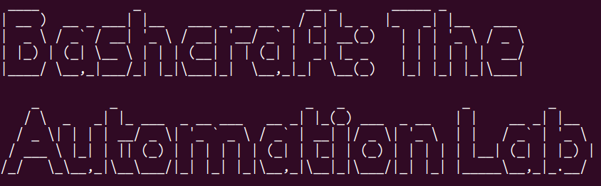

# ⚒️ Bashcraft: The Automation Lab




*From typing commands to scripting solutions. One shell at a time.*


Welcome to Bashcraft, my hands-on journey into Bash scripting, Linux, and command-line automation.


This repository documents my practical work as I revisit the fundamentals, explore advanced Bash features, experiment with automation, and learn to write scripts that solve real problems.

I'm following the Complete Bash Scripting Course by Dave Eddy from You Suck at Programming (YSAP). The goal isn't just to finish a seven-hour course. It's to understand what I'm learning, practise it, document my mistakes, and build a collection of scripts I can explain and use.

Because knowing a command is one thing. Knowing how to turn it into a solution is another.

---

##  The Mission

- Rebuild my Bash scripting fundamentals through hands-on practice.

- Understand Linux commands, file operations, permissions, and process management.

- Practise variables, functions, conditionals, loops, arrays, and command-line arguments.

- Explore text processing, parameter expansion, regular expressions, and shell behaviour.

- Develop practical automation scripts and improve my debugging skills.

- Document my learning through organised scripts and meaningful Git commits.

---

##  The Learning Map

The repository will grow alongside the course.

 Course Progress Tracker

| Stage | Course Topics | Practical Work | Status |
|:---:|---|---|:---:|
| 01 | Terminal and File Manipulation | Navigation, file operations, hidden files, searching and paging files | ⬜ |
| 02 | Man Pages and Commands | Man pages, programs, commands, and basic variables | ⬜ |
| 03 | Vim and File Permissions | Vim basics, `chmod`, and file permissions | ⬜ |
| 04 | Bash Scripting Fundamentals | User input, functions, conditionals, and `for` loops | ⬜ |
| 05 | Advanced Bash Data Handling | Case statements, indexed and associative arrays, IFS, command substitution, arithmetic, and process substitution | ⬜ |
| 06 | Text Processing | `cut`, `tr`, `sed`, `awk`, `grep`, and `find` | ⬜ |
| 07 | Arguments and Pipelines | Bash arguments, pipe status, and timing commands | ⬜ |
| 08 | Code Structure and Return Values | Sourcing code, curlies vs. parens, return vs. output | ⬜ |
| 09 | Parameter and Array Expansion | Parameter expansion and array expansion | ⬜ |
| 10 | Globbing and Brace Expansion | Basic and extended globbing, shell options, brace expansion, and numeric expansion | ⬜ |
| 11 | Output and Data Formatting | `printf`, date formatting, regular expressions, and `mapfile` | ⬜ |
| 12 | Tests and Process Communication | Brackets vs. `test`, special strings, traps, signals, and named pipes | ⬜ |
| 13 | Terminal Customisation | Colour output, cursor commands, TTY detection, PS1, Bash customisation, and Readline shortcuts | ⬜ |
| 14 | Debugging and Common Pitfalls | `ls` pitfalls, aliases with arguments, string length, and debugging | ⬜ |

**Status Key:** ⬜ Not started · 🟡 In progress · ✅ Completed

*The repository will grow alongside the course. Each stage represents a learning milestone, with progress updated as I complete the practical exercises and.*

##  Repository Structure

```plaintext
bashcraft-automation-lab/
├── README.md
├── assets/
│   ├── bashcraft-banner.png
│   └── terminal-practice.png
├── notes/
│   ├── 01-terminal-basics.md
│   ├── 02-variables.md
│   └── 03-loops-and-functions.md
├── scripts/
│   ├── hello.sh
│   ├── file-organiser.sh
│   └── system-info.sh
└── projects/
```

This is the planned structure. I'll add folders and scripts as I work through the material.

---

##  The Lab Rules

*Every script should have a purpose beyond existing in a folder.*

- **Practise:** Write and execute the script myself.

- **Understand:** Be able to explain what each important line does.

- **Test:** Check normal inputs, unexpected inputs, and possible errors.

- **Document:** Record the script's purpose and how to run it.

- **Improve:** Revisit earlier scripts as my understanding grows.

I'll also document errors and lessons learned. Debugging is part of the process, not something to hide.

---

##  Environment

- **Operating system:** Ubuntu Linux

- **Shell:** Bash

- **Editor:** A terminal editor or text editor

- **Version control:** Git and GitHub

---

##  Learning Resource

- **Primary resource:** The Complete Bash Scripting Course by Dave Eddy (YSAP)

---

##  Why Bash Matters to My Cybersecurity Journey

Bash is more than a way to execute commands. It can connect tools, process data, manage files, and automate repetitive work on Linux systems.

As I continue developing my cybersecurity skills, I want to become more comfortable working at the command line, understanding scripts, and automating legitimate administrative and defensive tasks.

This repository is one step towards that goal.

---

##  Progress Log

I'll update this section as I complete exercises and practical milestones.

Complete the course with hands-on practice.

Document scripts from each major topic.

Practise debugging and error handling.

Build small, useful automation projects.

Review and refine the repository.

---

### The Philosophy

Don't just run the command. Understand it. Don't just copy the script. Explain it. Don't just make it work. Learn why it works.

This is Bashcraft. The learning happens one script, one mistake, and one breakthrough at a time.

*Built through practice, curiosity, and a willingness to learn.*
