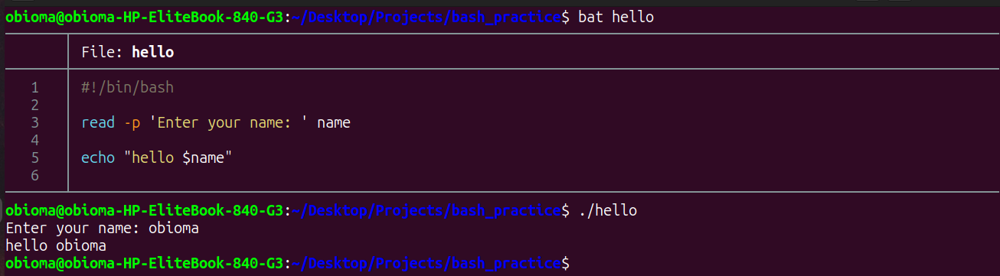

# Bash Scripting Note 2



## 1. Getting User Input
To make your scripts interactive you can ask the user to type something. You use the read command to pause the script and wait for input.

* read username: Waits for the user to type something and saves it in a variable called username.
* read -p "Enter your name: " username: The -p flag lets you print a message on the screen so the user knows what to type.

Example 
```bash
#!/bin/bash

read -p 'Enter your name: ' name

fi

echo "hello $name"
```

---

## 2. Getting Input from Arguments
When you run a script you can type words right after the script name. Bash automatically saves these words into numbered variables.

* $1 is the first word you typed after the script name.
* $2 is the second word and so on.
* $@ represents all the words you typed combined.

---

## 3. If and Else Statements
Conditionals let your script make decisions. The script checks if something is true and runs specific code based on the answer.

We use square brackets to test conditions. You must always leave spaces on the inside of the brackets or Bash will give an error.

Example script checking a number:

```bash
#!/bin/bash
read -p "What is your age? " age

if [ $age -ge 18 ]; then
    echo "You are an adult"
else
    echo "You are a minor"
fi
```

Here are the common ways to compare numbers:
* -eq means exactly equal to
* -ne means not equal to
* -gt means greater than
* -lt means less than
* -ge means greater than or equal to
* -le means less than or equal to

You can also use if statements to check if the user provided an argument before asking them to type one. Here is a script that checks if $1 has data. The -n checks if the variable is not empty.

```bash
#!/bin/bash

if [[ -n $1 ]]; then
    name=$1 
else
    read -p 'Enter your name: ' name
fi

echo "hello $name"
```

## 4. Functions
Functions let you group several commands together under one name. This saves you from typing the same code over and over again in different parts of your script.

Example of creating a function:

```bash
#!/bin/bash

say_hello() {
    echo "Hello there!"
    echo "Welcome to the system."
}
```
To run the function later in your script you just type its name:
say_hello

Inside a function you can also use the word local to create a variable that only exists inside that specific function. Functions can also hand back a number when they finish by using the return command.

``` greet() {
    local name=$1
    echo "hello $name (from func)"
    return 5
}
```
## 5. Looping Through All Arguments
You can use a for loop with $@ to grab every single argument a user typed and run code on each one.

You can also run one script from inside another script. In this example we run the hello script for every name provided and we use >> to push all the output into a text file instead of printing it on the screen.

```bash
#!/bin/bash

for name in "$@"; do
    ./hello "$name" >> file.txt
done
```


