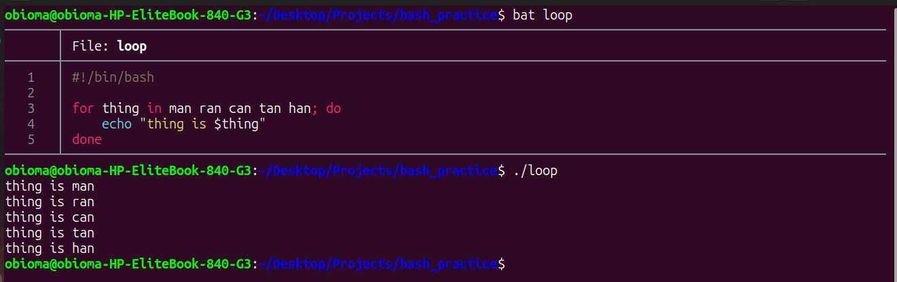

# Bash Scripting Note 3


## 1. More on Conditionals
You can compare variables to see if they match. When using double square brackets `[[ ]]`, you do not always need to put quotes around your variables.

* == means exactly equal to.
* != means not equal to.
* -f checks if a file exists and is a regular file.

Example of comparing two variables:
```
#!/bin/bash
a=2
b=2

if [[ $a ==$b ]]; then
    echo 'a and b are the same'
fi
```
You can also chain commands together using &&. The second command will only run if the first command succeeds. 
Example: ls && echo "ls worked"

---

## 2. While and Until Loops
Unlike an if statement that uses the word then, loops always use the word do. 

A while loop keeps running its code over and over as long as a condition is true. In this example the script keeps printing a message as long as file.txt exists. It uses sleep 1 to wait one second between checks so it does not overwhelm the computer.

```
#!/bin/bash
while [[ -f file.txt ]]; do
    echo 'file.txt exists and is a file'
    sleep 1
done
echo 'file is gone'
```

An until loop is the exact opposite. It keeps running its code over and over as long as a condition is false. It stops as soon as the condition becomes true.

```
#!/bin/bash
until [[ -f file.txt ]]; do
    echo 'file.txt does not exist'
    sleep 1
done
echo 'file exists'
```

---

## 3. Other Ways to use For Loops
You can use curly braces to make a loop run a specific number of times without typing every number manually. This is called brace expansion.

```
#!/bin/bash
for thing in {1..5}; do
    echo "thing is $thing"
done
```
You can also write loops using standard math logic similar to other programming languages.

```
#!/bin/bash
max=5
for ((i = 0; i < max; i++)); do
    echo "Count is $i"
done
```
---

## 4. Input and Output Tricks
When reading user input the computer also reads the invisible Enter key you press at the end. You can use tools like xxd or hexdump to see the raw data the computer sees.

For example running echo hello | xxd shows a hidden 0a at the end which is the computer code for a new line.

---
## 5. Bringing It All Together
You can combine everything into a single script. For example a recap script can check if the user provided arguments. If they did not it prints "name required!". If they did it uses a for loop to grab every name from $@ and uses an if statement inside the loop to decide whether to say hello or goodbye to each person.


