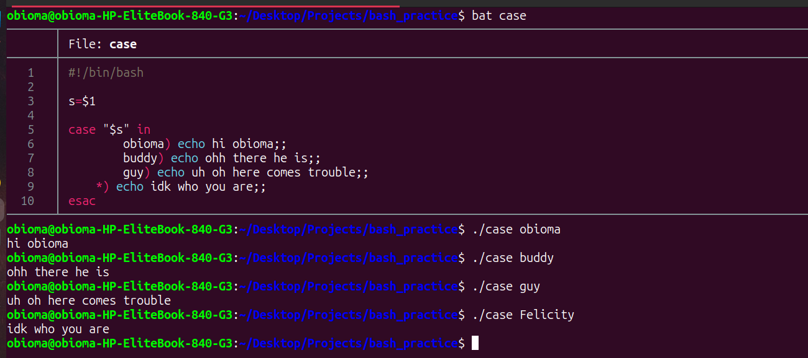

# Bash Scripting Note 4



## 1. Case Statements
A case statement is a much cleaner way to write multiple if and else conditions. Instead of writing if this, else if this, else if that, you just match a variable against a list of patterns.

* You start with the word case and end with the word esac backwards for case.
* You close each matching word with a single parenthesis `)`.
* You must end the code inside each match with double semicolons `;;`.
* The `*)` acts as a default catch-all if nothing else matches.

Here is the exact script you built:

```
#!/bin/bash
s=$1

case "$s" in
    obioma) echo "hi obioma" ;;
    buddy) echo "ohh there he is" ;;
    guy) echo "uh oh here comes trouble" ;;
    *) echo "idk who you are" ;;
esac
```

You can also combine a case statement inside a for loop. This is how you got your script to say hello to buddy and duddy, but goodbye to everyone else in your arguments:

```
#!/bin/bash
for name in "$@"; do
    case "$name" in
        b*|d*) echo "hello $name!" ;;
        *) echo "goodbye $name!" ;;
    esac
done
```

*Note on Fall-Through:* Normally the double semicolon `;;` tells Bash to stop looking as soon as it finds a match. In your `alwaysfallthrough` script, you learned that using `;&` or `;;&` instead tells Bash to keep falling through and check the other options too. This is why your script printed both "matched f*" and "matched foo".

---

## 2. Indexed Arrays
An array is simply a variable that holds a list of multiple items instead of just one single word. In Bash, the first item in an array is always at position 0.

* Create an array: `array=(foo bar baz)`
* Read the first item: `echo "${array[0]}"` prints foo
* Read the second item: `echo "${array[1]}"` prints bar

To expand on this, here are two very useful array tricks:
* Read every item at once: `echo "${array[@]}"`
* Count how many items are in the array: `echo "${#array[@]}"`

---

## 3. Command Substitution
Command substitution lets you run a command and save its output directly into a variable so you can use it later. 

You do this by wrapping the command inside a dollar sign and parentheses `$()`.

```
#!/bin/bash
current_files=$(ls)
echo "Here are your files: $current_files"
```

You can also use this to capture the output of your own functions. If you have a function that prints a word, you can save that word to a variable using `thing=$(my_func)`.

---

## 4. The IFS Variable
IFS stands for Internal Field Separator. It is a hidden system variable that tells Bash how to separate words. 

By default, Bash uses spaces, tabs, and new lines to separate words. But if you are reading a CSV file where words are separated by commas, you can temporarily change the IFS to a comma. 

`IFS=','`
Now Bash will automatically split your data exactly where the commas are.


---

## 5. Arithmetic Expressions
Bash can do math, but you have to tell it that you are working with numbers, not text. You do this using double parentheses `(( ))`.

* Basic math: `result=$((5 + 5))`
* Adding one to a variable: `((i++))`
* Checking if a number is greater: `(( i > 5 ))`
