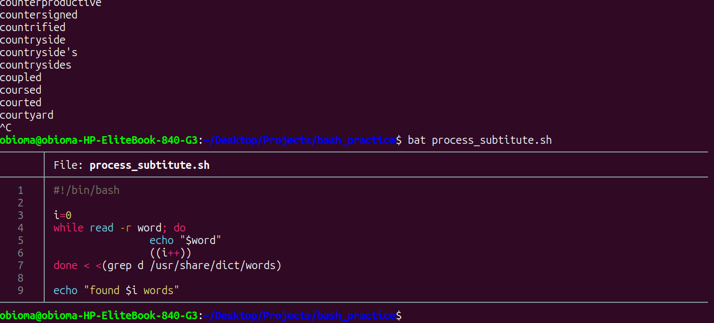

# Bash Scripting Note 5



## 1. Process Substitution
Sometimes you want to search through a massive list and count the results using a `while` loop. 

If you use a standard pipe `|` to send data into a loop, Bash puts that loop into a hidden background box (called a subshell). When the loop finishes, the box is destroyed, and your counting variable gets erased and goes back to zero.

To fix this we use Process Substitution. It looks like `< <(command)`. This feeds the data into the loop directly without creating that hidden box, so your variables are saved.

Here is the exact script you built to count words containing the letter "d" in the Linux dictionary:

``` 
#!/bin/bash
i=0
while read -r word; do
    echo "$word"
    ((i++))
done < <(grep d /usr/share/dict/words)

echo "found $i words"
```

---

## 2. Shaping Text with tr and cut
When you are looking at files like CSVs (Comma Separated Values), you often need to clean up the data or grab specific columns.

* tr: Stands for translate. It swaps one character for another.
Example: Swapping commas for tabs (`\t`) to make it easier to read.
`cat simple.csv | tr , '\t'`

* cut: Acts like a pair of scissors to cut out specific columns. You use `-d` to set the delimiter (the character splitting the words) and `-f` to choose the field (column) number.

Example: Grabbing just the names (column 1) from the CSV.
`cat simple.csv | cut -d , -f 1`

Example: Grabbing names and cities (columns 1 and 3).
`cat simple.csv | cut -d , -f 1,3`

Example: Looking at Linux users by grabbing the username and the shell from the password file.
`cat /etc/passwd | cut -d : -f 1,7`

---

## 3. Finding Text with grep
The `grep` command is like a search engine for your terminal. It filters text and only shows you the lines that contain the exact word you are looking for.

Example: Searching the password file to only show the line for the user "obioma".
`cat /etc/passwd | grep obioma`

---

## 4. Replacing Text with sed
The `sed` command stands for Stream Editor. It is most famous for doing "Find and Replace" on text using Regular Expressions (regex). 

The basic structure is `sed 's/find/replace/'`. The `s` stands for substitute.

Example: Finding the word "dave" and replacing it with the word "bob".
`cat /etc/passwd | grep dave | sed 's/dave/bob/'`

Example: Using regex wildcards. A dot `.` means "any single character". So `d...e` will match "dave", "dome", "duke", etc.
`echo "hello dave" | sed 's/d...e/bob/'` 

---

## 5. Advanced Text Processing with awk
The `awk` command is a full programming language built just for text processing. It is like a much smarter version of `cut`. 

Instead of just cutting columns, `awk` can cut them, flip them around, and add custom text between them. You use `-F` to set the field separator (like the colon in the password file).

Example: Grabbing column 1 and column 7, and printing a space between them.
`cat /etc/passwd | awk -F: '{ print $1 " " $7 }'`

---

## 6. Locating Files with find
The `find` command searches your computer for files and folders.

* Find absolutely everything in your current folder:
`find .`

* Find only files (ignoring folders):
`find . -type f`

* Find all files that end with ".sh":
`find . -name "*.sh"`

---

## 7. Checking Your Code with Shellcheck
Shellcheck is a lifesaver. It is an automatic spell-checker and bug-finder for Bash scripts. 

Before you run a complex script, you can run it through Shellcheck. It will read your code, point out any formatting mistakes, warn you about variables that need quotes, and tell you exactly how to fix them.

Example:
`shellcheck myscript.sh`
